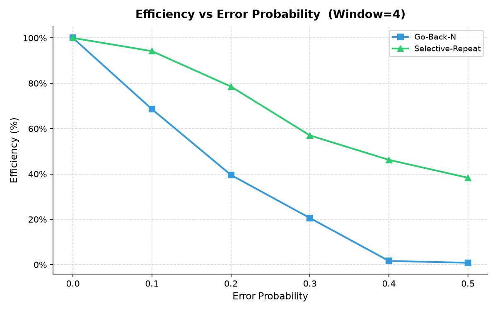
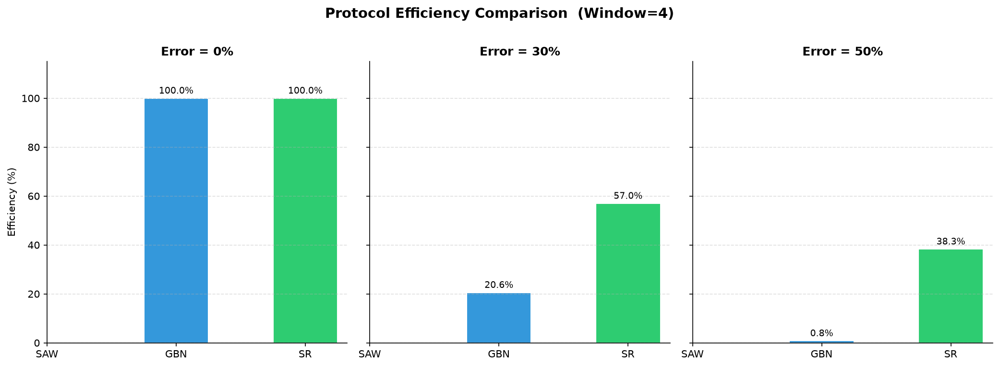
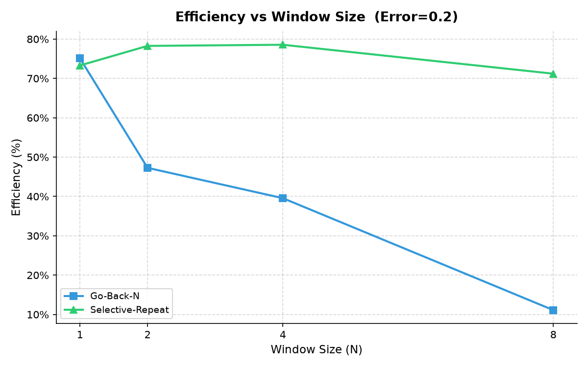
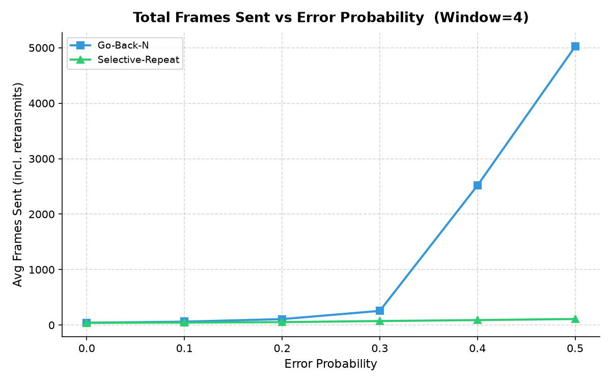
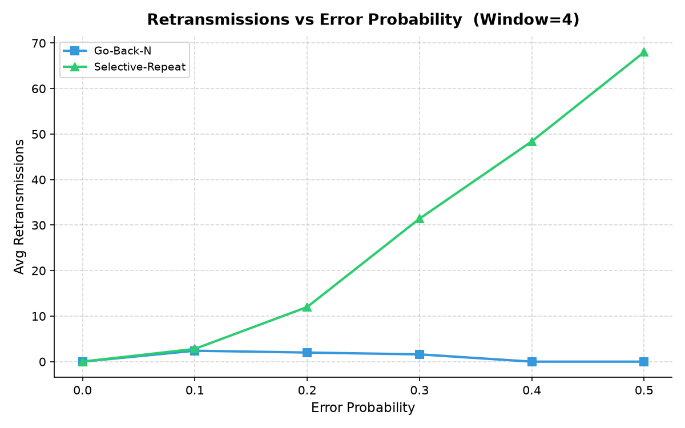
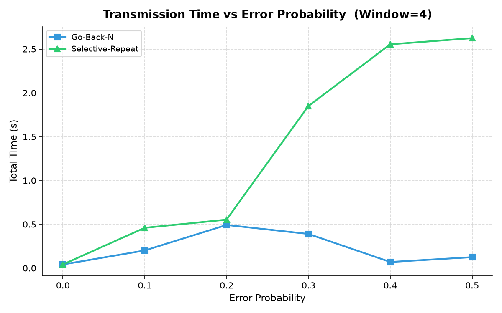

# ARQ Flow-Control Protocol Simulator

A C-based simulation of reliable data transfer over an unreliable channel. The project implements and compares three Automatic Repeat reQuest (ARQ) flow-control protocols:

- **Stop-and-Wait**
- **Go-Back-N (GBN)**
- **Selective Repeat (SR)**

The sender and receiver communicate over a TCP loopback connection while the channel module simulates frame loss and single-bit corruption. CRC-32 detects corrupted payloads, and the sender retransmits according to the selected protocol.

## Features

- Fixed-size data-link frames with source/destination MAC fields, sequence numbers, frame types, payloads, and CRC-32 trailers.
- Configurable frame-loss and bit-error probabilities.
- Adaptive retransmission timeout based on measured round-trip time.
- Stop-and-Wait, Go-Back-N, and Selective Repeat sender/receiver behavior.
- Automated experiment runner that produces CSV, Excel, and PNG graph outputs.
- A standalone protocol simulation for fast aggregate comparisons.

## Requirements

- Linux or another POSIX-compatible environment
- GCC and `make`
- Python 3 (for automated experiments)

To generate Excel workbooks and graphs, install the optional Python packages:

```bash
python3 -m pip install pandas matplotlib openpyxl
```

## Build

```bash
make
```

This produces three executables: `sender`, `receiver`, and `experiment`.

## Run a File Transfer

Start the receiver first in one terminal:

```bash
./receiver <mode> <window_size> [output_file]
```

Then, in a second terminal, start the sender:

```bash
./sender <mode> <window_size> <error_prob> <loss_prob> <input_file>
```

### Parameters

| Parameter | Description |
| --- | --- |
| `mode` | `1` = Stop-and-Wait, `2` = Go-Back-N, `3` = Selective Repeat |
| `window_size` | Window size from 1 to 64; used by GBN and SR |
| `error_prob` | Bit-error probability from 0.0 to 0.5 |
| `loss_prob` | Frame-loss probability from 0.0 to 0.5 |
| `input_file` | File to transmit |
| `output_file` | Optional receiver output filename; defaults to `received_output.bin` |

Example: run Selective Repeat with a window size of 4, a 10% bit-error rate, and a 5% loss rate:

```bash
# Terminal 1
./receiver 3 4 received_output.bin

# Terminal 2
./sender 3 4 0.10 0.05 input.txt
```

After a successful run, compare the reconstructed output with the input:

```bash
cmp input.txt received_output.bin
```

No output from `cmp` means the files match.

## Run Experiments

### Socket-based test matrix

The Python harness runs combinations of protocols, windows, error rates, and loss rates, then creates `results.csv`, `results.xlsx`, and plots in `graphs/`.

```bash
python3 run_experiments.py --quick
```

For the complete test matrix:

```bash
python3 run_experiments.py --trials 3
```

### In-process aggregate simulation

For a faster comparison that does not open sockets:

```bash
./experiment
```

The results are saved to `experiment_results.csv`.

## Experimental Results

The following plots were generated by `run_experiments.py`. They compare Go-Back-N and Selective Repeat using a window size of 4 unless otherwise stated. Stop-and-Wait is omitted from some plots where its results were not collected for the corresponding comparison.

### Efficiency under channel errors

Selective Repeat retains substantially higher efficiency as the simulated error probability increases. At a 50% error probability, the recorded efficiency is approximately 38.3% for Selective Repeat, compared with 0.8% for Go-Back-N.





### Effect of window size

At an error probability of 0.2, Selective Repeat remains comparatively stable as the window size grows, whereas Go-Back-N efficiency drops sharply for larger windows because it retransmits the remaining window after a loss or error.



### Transmission cost and time

As error probability increases, Go-Back-N sends many more frames because it retransmits a sequence from the failed frame onward. Selective Repeat retransmits individual failed frames, resulting in far fewer total transmissions in the recorded runs. The time and retransmission plots show the observed execution-time and retry behavior for the same experiment set.







## Project Layout

| File | Purpose |
| --- | --- |
| `sender.c` | Sender implementations for the three ARQ protocols |
| `receiver.c` | Receiver implementations and ACK/NAK handling |
| `frame.h` | Frame and acknowledgement structures |
| `channel.c`, `channel.h` | Loss and corruption simulation |
| `crc.c`, `crc.h` | CRC-32 calculation and validation |
| `checksum.c`, `checksum.h` | Checksum support module |
| `experiment.c` | In-process protocol comparison simulation |
| `run_experiments.py` | Automated socket-based experiments and report artifacts |
| `graphs/` | Generated efficiency, retransmission, frame-count, and timing plots |
| `Makefile` | Build targets |

## Clean Build Artifacts

```bash
make clean
```

This removes compiled executables and generated transfer/experiment output files listed in the Makefile.
